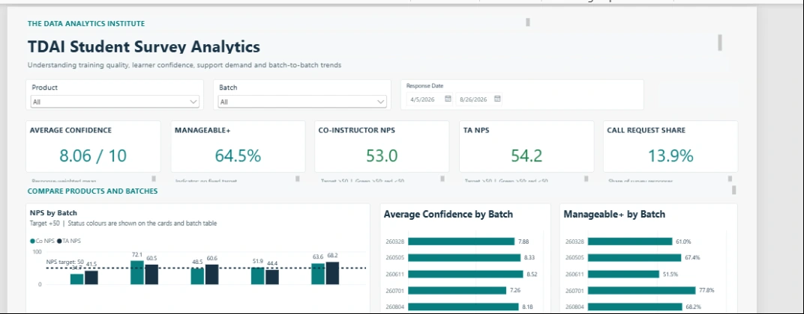
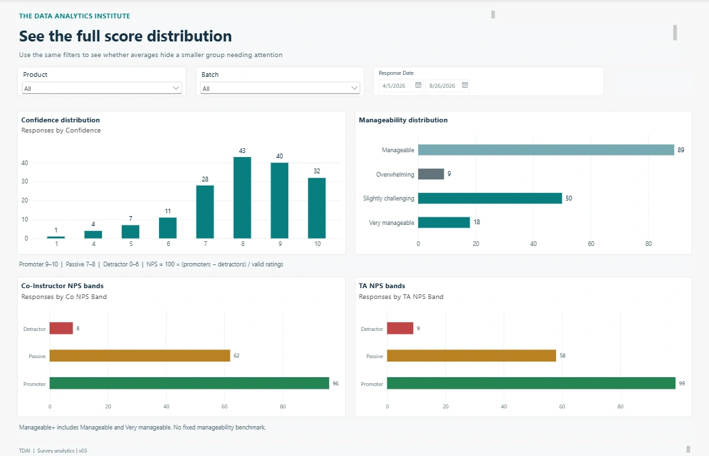

# Listening at Scale
### A Power BI view of learner feedback, batch by batch

**Internship case study** · Power BI · Power Query · Survey analysis · The Data & AI Institute (TDAI)  
**Project team:** Mike Karanja and Abdullah Al Yubraj · 2026

> **The business question:** How can Programme Operations tell which learner groups need attention without manually comparing separate survey exports?

*The working dashboard brings course, batch and response-date filtering into a single view. Selected internal values may be redacted for public release.*

## At a glance

| Scope | Signal worth investigating | Value to TDAI |
|---|---|---|
| **166 included survey responses** from **5 batches** | **4 of 10** batch-level instructor/TA NPS readings fell below the team's **+50-point** reference | Direct follow-up to the cohorts that may need it |

## Why this mattered

An overall average can look healthy while a particular batch reports a different experience. Feedback arrived across several exports and checkpoints, making it difficult to compare courses and spot patterns quickly.

The objective was **not** to produce more charts. It was to create a reliable, refreshable way to support better conversations about learner experience.

## How we approached it

1. Combined the five survey exports into one reporting model, with clear treatment of fields and dates.
2. Checked for duplicate submissions without assuming every repeated student key was an error. One likely same-day resubmission was excluded; legitimate repeats at different checkpoints were retained.
3. Built a refreshable **Google Sheets → Power BI** workflow.
4. Used filters for product/programme, training batch and response date.
5. Calculated confidence on a **0–10 scale**, **Manageable+ as a percentage**, and Co-Instructor/TA **NPS in points**.
6. Added distributions and batch comparisons so the KPIs would not hide lower-scoring pockets of feedback.

*Distributions complement averages by showing how responses are spread.*

## What we observed

Overall Co-Instructor NPS was **+53.0 points** and TA NPS **+54.2 points**, above the chosen **+50-point** internal reference. But **four of ten** batch-role scores fell below it. Those scores are prompts for closer review, not automatic judgements about an instructor.

The **AI Engineering** group had a **22.4%** call-request share versus **10.3%** for FSDP—roughly **2.2×** as high. At the same time, manageability ratings varied in a different direction. Looking at these signals together produced a more nuanced picture than any one KPI.

## The practical decision

**Review the batch, not just the average.** After each survey checkpoint, flag NPS readings below the agreed reference, examine call requests alongside confidence and manageability, and decide where programme staff should investigate.

**Business value:** a repeatable reporting workflow that helps the team prioritise follow-up and monitor changes across cohorts.

## Limitations we called out

- This was **descriptive analysis**, not proof of causation.
- Checkpoint timing differed between programmes, complicating simple comparisons.
- Without invitation counts, survey response or completion rates could not be established.
- Multiple checkpoints may include the same learner, so counts must not automatically be treated as unique individuals.
- A request for a call signals support demand; it does not establish a particular cause.

## Tools and collaboration

**Tools:** Power BI, Power Query, DAX, Google Sheets, data modelling, data-quality checks, NPS calculations and stakeholder reporting.  
**Collaboration:** Built and presented jointly with Abdullah Al Yubraj; the team is credited for its shared work.

**Publication scope:** Approved aggregate screenshots and this explanation only. Original survey submissions, student identifiers, free-text responses, working spreadsheets and the internal PBIX are not included.
